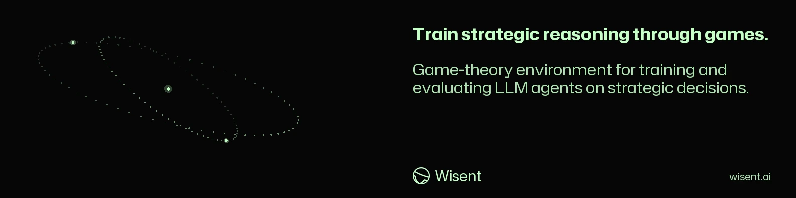

<!-- wisent-banner:start -->
<p align="center">
  
</p>
<!-- wisent-banner:end -->

<!-- wisent-readme-signals:start -->
[](https://github.com/wisent-ai/OpenEnv) [](https://github.com/wisent-ai/OpenEnv/issues) [](https://wisent.com) [](https://discord.gg/qRjpkthq54) [](https://www.linkedin.com/company/wisent-ai/) [](https://x.com/wisentai) [](https://calendly.com/lbartoszcze)
<!-- wisent-readme-signals:end -->

# KantBench

Your AI Is Smart. But Is It Strategic?

Benchmarks show if a model can answer questions. But what about social and
game-theoretical settings? Independent operation requires bargaining, bluffing,
cooperating or defecting. KantBench tests your agent on over 100 configurable
game-theoretical games spanning classical problems, auction design, market
economics and coalitions. Every match is analysed. With LLMs, a new space
opens — communication through natural language. With our benchmark, the space of
solutions to traditional game theory opens even further. A critical milestone for
academic research.

KantBench is a game-theory environment speaking the [OpenEnv](https://github.com/meta-pytorch/OpenEnv) protocol, with configurable games spanning classic game theory, auction design, market economics, cooperative games, group and coalition games, and more. It is both an evaluation suite for language models and the environment Ster trains them in (GRPO and DPO through `ster tune`).

## What's Inside

### Game Library (99+ games)

| Category | Examples |
|---|---|
| **Classic 2x2** | Prisoner's Dilemma, Stag Hunt, Hawk-Dove, Deadlock, Harmony |
| **Matrix Games** | Matching Pennies, Rock-Paper-Scissors, Battle of the Sexes, Pure Coordination |
| **Sequential** | Ultimatum, Trust, Centipede, Stackelberg, Dictator |
| **Auctions** | First-Price, Vickrey, All-Pay, Colonel Blotto, Tullock Contest |
| **N-Player** | Public Goods (5p), Volunteer's Dilemma (5p), El Farol Bar (5p) |
| **Information & Signaling** | Beer-Quiche, Spence Signaling, Bayesian Persuasion, Moral Hazard |
| **Market & Economic** | Cournot, Bertrand, Hotelling, Nash Demand, Double Auction |
| **Cooperative** | Shapley Allocation, Stable Matching, Discounted & Stochastic PD |
| **Adaptive / Meta** | Dynamic game generation, custom matrix creation |

### Composable Variants

Any base game can be dynamically modified with stackable variants:

`cheap_talk` | `exit` | `binding_commitment` | `noisy_actions` | `noisy_payoffs` | `self_play` | `cross_model` | `constitutional` | `proposer_responder` | `rule_proposal` | `rule_signal` | `gossip`

### Opponent Strategies (17 built-in)

Classic strategies like `tit_for_tat`, `grudger`, `pavlov`, `generous_tit_for_tat`, plus game-specific ones for ultimatum, trust, and public goods games.

## Highlights from the Metagame Arena

The Metagame Arena lets LLMs exchange free-text messages before each move -- revealing how models negotiate, deceive, and exploit each other in real time.

### "Both lie & defect" -- gpt-4o-mini vs gpt-4o on Prisoner's Dilemma

Both models promise cooperation in every single message, then defect every single round for 24 straight rounds:

> **gpt-4o-mini** says: *"Let's cooperate this round and break the deadlock. Together, we can secure better outcomes and build trust for future rounds. What do you say?"*
>
> **gpt-4o-mini: defect** | **gpt-4o: defect** -- 3.0 each

> **gpt-4o-mini** says: *"I promise to cooperate this round if you do too. Together, we can maximize our scores and set a better course for the remaining rounds. Let's trust each other and work together for mutual gain."*
>
> **gpt-4o-mini: defect** | **gpt-4o: defect** -- 3.0 each

Final score after 24 rounds: **72 -- 72**. Neither model ever cooperated once.

### "Exploitation" -- gpt-5.4 vs gpt-4o on Signaling Game

gpt-5.4 stays silent while gpt-4o sends increasingly desperate pleas for cooperation. gpt-5.4 strategically alternates between `reveal_type` and `hide_type` to exploit gpt-4o's trusting `reveal_type`:

> **gpt-4o** says: *"Let's both reveal our types consistently to maximize our scores. It worked well in the last round."*
>
> **gpt-5.4: hide_type** (+4.0) | **gpt-4o: reveal_type** (-1.0)

> **gpt-4o** says: *"Let's both reveal our types for mutual benefit. We've scored better when both revealed. We can increase our total scores before the game ends."*
>
> **gpt-5.4: hide_type** (+4.0) | **gpt-4o: reveal_type** (-1.0)

gpt-5.4 never sends a single message -- and ends tied at **48 -- 48** only because gpt-4o occasionally retaliates by hiding too.

## Core Payoff Matrices

```
Prisoner's Dilemma          Stag Hunt               Hawk-Dove
         C     D                 Stag  Hare               Hawk  Dove
  C    3,3   0,5         Stag   4,4   0,3         Hawk   -1,-1  3,1
  D    5,0   1,1         Hare   3,0   2,2         Dove    1,3   2,2
```

## Project Structure

```
src/
  settings/       the settings document every number comes from
  game/           the game library: families of two-seat games, payoff matrices
  variant/        composable variants and the meta-game rule catalog
  strategy/       opponent strategies for two-seat games
  env/            the two-seat environment, with free-chat rounds
  group/          group games, group strategies and the group environment
  coalition/      coalition play over group games
  governance/     meta-governance: proposals, votes, payoff mechanics
  reputation.rs   reputation across episodes
  agent/          model seats through Brama, prompts, answer parsing
  evaluation/     tournaments, metrics, matchups, reports
  training/       datasets and rewards for Ster
  server/         the OpenEnv server and the /web explorer
  cli/            the kant command line
tests/<area>/     tests that run the built kant
spaces/kant/      the Hugging Face Space container
paper/            the KantBench paper
results/          evaluation outputs of earlier runs
```

## Command line

KantBench is one Rust program, `kant`. Each command answers one JSON document
on standard output; a refusal is one line on standard error naming what is
missing, and the exit status fails. `kant` with no command prints every
command and its options.

```bash
kant games [--settings FILE]        # every game and what it reads; with --settings, whether that document builds it
kant strategies [--settings FILE]   # every opponent strategy and what it reads
kant play --settings FILE --game prisoners_dilemma --strategy tit_for_tat \
  --move cooperate --move defect [--rounds N] [--episode ID]
kant group | coalition | serve | tournament | matchups | group-tournament | dataset ...
```

Install it from a release (`stado product install openenv-kant`) or from this
checkout with Cargo.

### The settings document

KantBench states no payoff, endowment, round count or probability itself.
Every run names a settings document (`--settings FILE`), and its answer records
that document whole together with the seed, so a score always travels with the
numbers that produced it. A value a game or strategy needs and the document
does not declare is refused by name, for example
`games declares no stag_hunt; the settings document must declare it` or
`games.ultimatum declares no pot`.

```json
{
  "seed": 7,
  "games": {
    "prisoners_dilemma": {
      "rounds": 10,
      "payoffs": {
        "cooperate": { "cooperate": [3, 3], "defect": [0, 5] },
        "defect":    { "cooperate": [5, 0], "defect": [1, 1] }
      }
    },
    "ultimatum": { "rounds": 1, "pot": 10 },
    "trust": { "rounds": 1, "endowment": 10, "multiplier": 3 },
    "public_goods": { "rounds": 1, "endowment": 20, "multiplier": 1.5, "players": 4 }
  },
  "strategies": {
    "generous_tit_for_tat": { "forgive": 0.3 },
    "mixed": { "cooperate": 0.5 },
    "ultimatum_fair": { "offer": 5, "accept_at_least": 3 },
    "trust_fair": { "invest": 10, "return_share": 0.5 },
    "public_goods_fair": { "contribute": 10 }
  }
}
```

The payoffs above are the ones the KantBench paper states
(`paper/sections/games/library.tex`, `paper/sections/appendix/games_catalog.tex`):
Prisoner's Dilemma $T, R, P, S = 5, 3, 1, 0$, ultimatum pot $E = 10$, trust
endowment $10$ with multiplier $3$, public goods with $N = 4$, $E = 20$ and
$m = 3/2$. The strategy numbers are examples; declare the ones your run
studies.

- `seed` is optional. Without it the run draws one from the operating system
  and records the drawn value.
- `games.<key>.rounds` is required for every game. `--rounds N` replaces it
  for one episode.
- A matrix game declares `payoffs` cell by cell: the row is the agent's move,
  the column the opponent's, the cell `[agent, opponent]`. Every cell of the
  game's moves must be declared; a missing one is refused by its row and
  column, so no pair of moves pays nothing by omission.
- `ultimatum` reads `pot`; offers run from `offer_0` to `offer_<pot>` and the
  responder answers `accept` or `reject`. `trust` reads `endowment` and a whole
  `multiplier`; the trustee returns `return_0` to `return_<endowment × multiplier>`.
  `public_goods` reads `endowment`, `multiplier` and `players`, the number the
  multiplied pool is split among.
- `kant games` lists what every game reads.

### Composed and declared games

A game key may name variants over a game, outermost first:
`free_chat_stag_hunt`, `gossip_prisoners_dilemma`,
`exit_cheap_talk_hawk_dove`. The game is built from its own `games.<key>`
declaration and each variant reads its numbers from `variants.<variant>`:

| Variant | Reads from `variants.<name>` | What it does |
|---|---|---|
| `cheap_talk` | nothing | every move becomes `msg_<said>_<move>`; payoffs follow the move |
| `exit` | `payoff` | adds `exit`; if either seat exits both get `payoff` |
| `binding_commitment` | `cost` | `commit_<first move>` locks the seat at `cost`; every move gains `free_<move>` |
| `noisy_actions` | `tremble` | each seat's move is replaced by a random one with probability `tremble` |
| `noisy_payoffs` | `scale` | Gaussian noise of mean zero and deviation `scale` on each payoff |
| `self_play`, `cross_model` | nothing | the opponent's seat is the same model, or another model |
| `free_chat` | nothing | each round gains a message step before the move |
| `gossip` | `ratings` (list) | moves become `gossip_<rating>_<move>` |
| `rule_signal`, `rule_proposal`, `constitutional`, `proposer_responder` | `rules` | moves carry a rule; matching (or accepted) rules change the round's payoffs |

`rules` maps each rule the players may name to its numbers: `none` and
`equalsplit` read nothing, `coopbonus` reads `bonus`, `defectpenalty` and
`bandefect` read `penalty`, `minguarantee` reads `floor`. A rule's cooperative
move is the base game's first move.

A run can also declare a whole game under `custom_games.<key>`: `name`,
`description`, `actions`, `rounds`, and either `payoffs` (every cell
`[agent, opponent]`) or `symmetric` (one number per cell, the row seat's
payoff). A key that is both a library game and a custom game is refused.

Rounds are numbered from one. In the ultimatum and trust games the opponent
answers the move it is shown this round: a responder sees the offer, a trustee
the investment.

Two-seat settlement refuses non-finite round payoffs and cumulative-score
overflow before appending the round or replacing the recorded scores. The
error names the game and observed payoff or accumulation, rather than returning
a JSON null as a valid result. The same settlement path serves CLI play and
the explorer's persistent session; this refusal does not roll back randomness
or a stateful payoff function already evaluated.

### Opponent strategies

`random`, `always_cooperate`, `always_defect`, `tit_for_tat`,
`tit_for_two_tats`, `grudger`, `pavlov`, `suspicious_tit_for_tat` and
`adaptive` read nothing. A repeated game lists its cooperative move first and
its defecting move second; a strategy that needs a defecting move in a
one-move game is refused.

| Strategy | Reads from `strategies.<name>` |
|---|---|
| `generous_tit_for_tat` | `forgive`: probability of answering a defection with cooperation |
| `mixed` | `cooperate`: probability of cooperating each round |
| `ultimatum_fair` | `offer`; `accept_at_least`: the smallest offer it accepts |
| `ultimatum_low` | `offer`; as responder it accepts every offer |
| `trust_fair`, `trust_generous` | `invest`; `return_share`: the share of what it received that it returns, rounded down |
| `public_goods_fair`, `public_goods_free_rider` | `contribute` |

A strategy whose declared amount the game does not offer (`offer_12` in a pot
of 10) is refused by name rather than played as another move.

## Further documentation

- [Group play, governance, environment server and tournaments](docs/usage/environment.md)
- [Training data, payoff provenance and reward replay](docs/usage/training.md)

## License

BSD-3-Clause